# SwitchShelf

[简体中文](README.md) | **English**

A native macOS Switch library and device manager with sphaira MTP installation, installed-content inventory, file management, and screenshots.

Built with SwiftUI for macOS 26+ and Apple Silicon, with a native Liquid Glass design. The application UI is currently primarily in Chinese; this repository provides documentation in Chinese and English.

## Features

- **Game library**: Scan local folders and mounted SMB/NAS shares. Browse covers, base games, updates, and DLC in grid or list view, with search, filters, and sorting.
- **Installation staging**: Build an installation plan, select base/update/DLC files, transfer them serially through sphaira MTP, and check installation results independently.
- **Device inventory**: Inspect USB detection, MTP storages, and inventory coverage. Read installed content from sphaira's `Games` or DBI's `Installed games` storage.
- **File management**: Browse device storage and folders, search and sort files, and access single-file uploads and downloads.
- **Album screenshots**: Browse, search, preview, and download images from the device album.
- **Wireless and maintenance**: Use a separate DBI FTP connection page and manage local sources, caches, scan issues, and settings.

## Screenshots

These screenshots were captured from a running SwitchShelf 0.3.6 on October 30, 2026. USB and FTP were disconnected during capture. The device content list shows a historical cache and does not establish the device's current installation state. Click an image to view the original.

**Library · Grid view** — Browse covers, content types, and sizes. Find games with search, filters, and sorting.

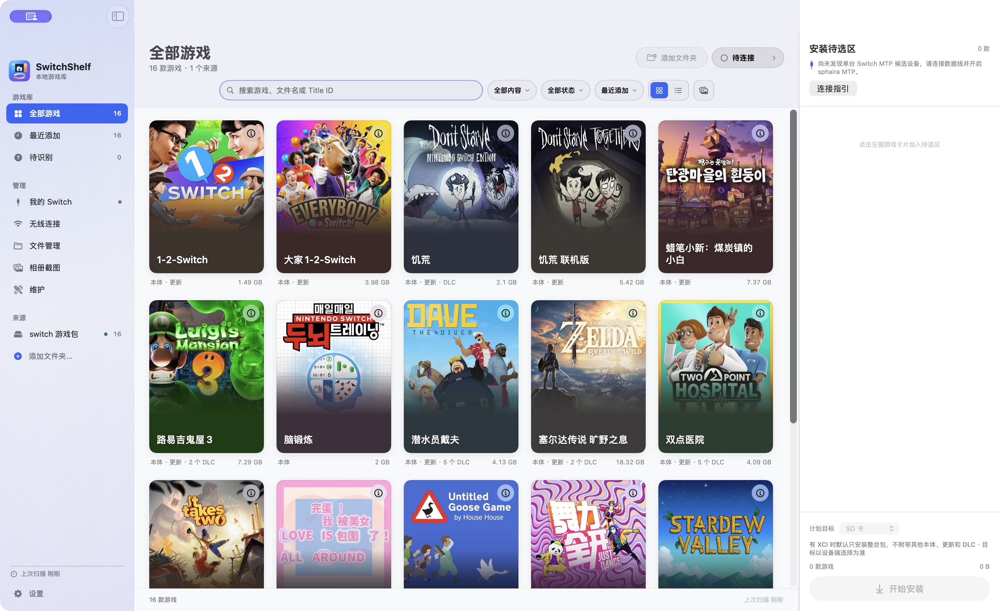

<details>
<summary>Library · List view</summary>

The list shows game titles, base/update/DLC content, file counts, sources, and sizes.

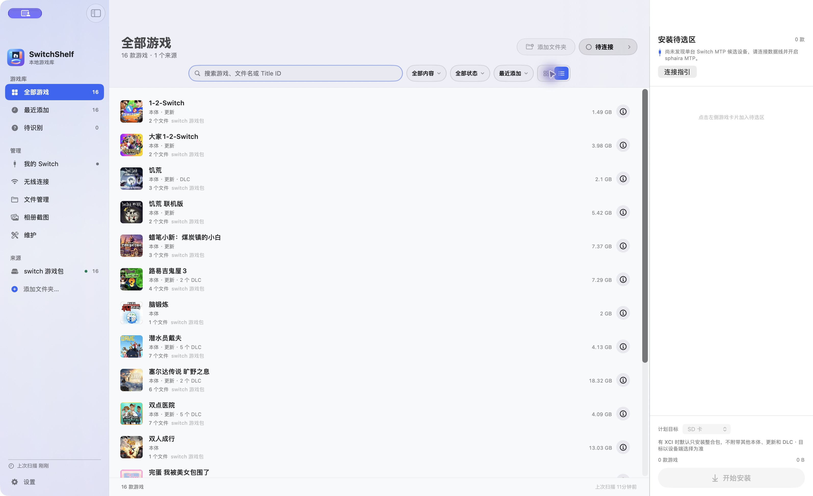

</details>

<details>
<summary>Game details and installation staging</summary>

The details popover shows artwork, matching information, and the evidence behind installation status. Click a game card to add it to the staging sidebar, expand its base/update/DLC selections, and inspect the planned destination and total size. The start button is disabled in this screenshot because no device is connected.

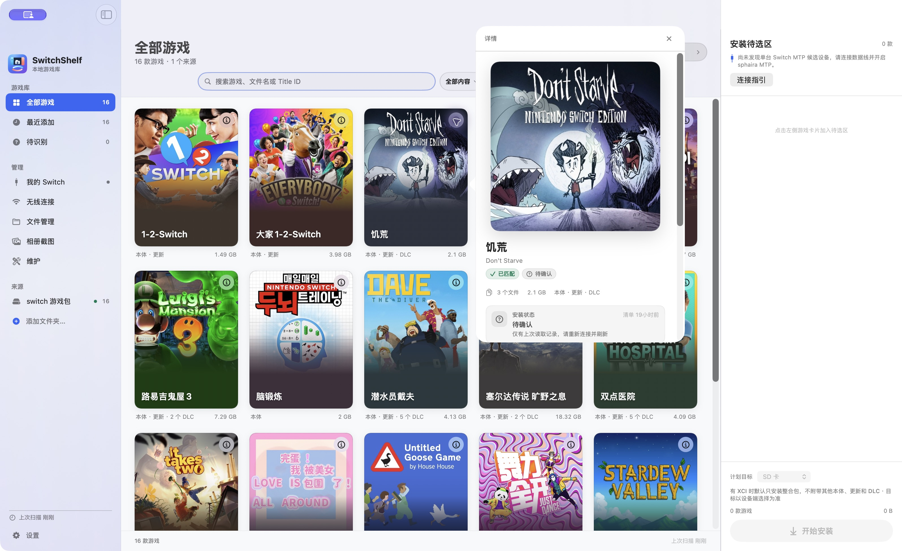

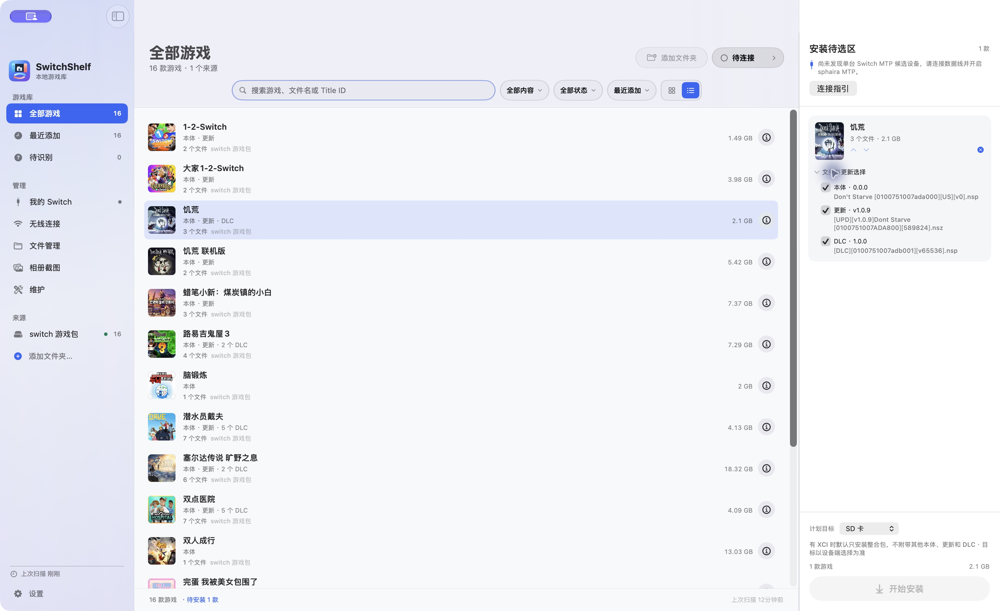

</details>

<details>
<summary>My Switch · Device overview and content inventory</summary>

The device page shows USB detection, inventory sessions, storage entries, and coverage. The searchable content list groups base games, updates, and DLC by game. The images below show a historical inventory while disconnected.

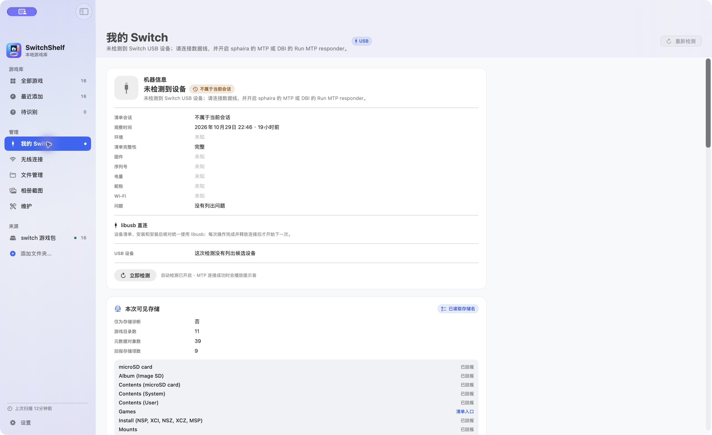

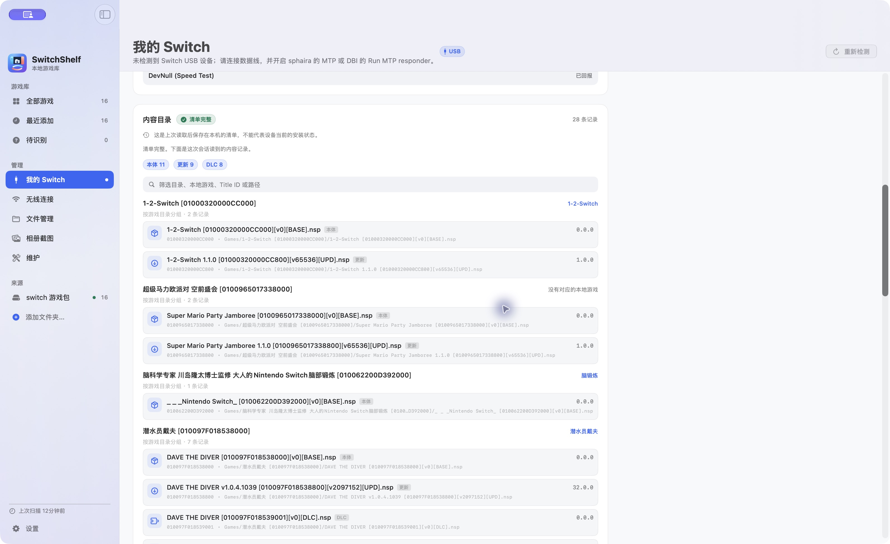

</details>

<details>
<summary>Wireless connection · DBI FTP</summary>

Enter the host and port, follow connection guidance, and inspect read-only probe results. This screenshot shows the disconnected state.

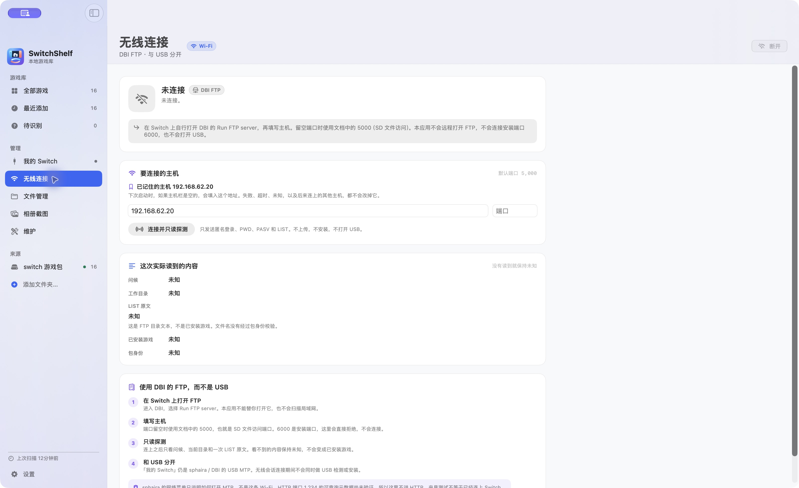

</details>

<details>
<summary>File management</summary>

Device storage, folder navigation, search, sorting, and single-file upload/download controls. This screenshot shows the page waiting for a device.

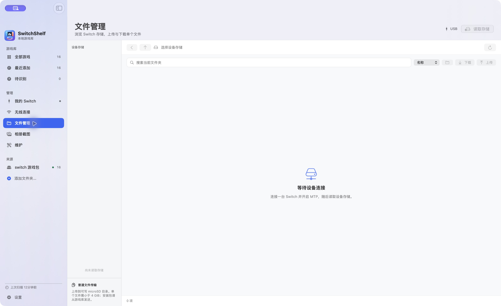

</details>

<details>
<summary>Album screenshots</summary>

Album search, image preview, and download controls. This screenshot shows the page waiting for a device.

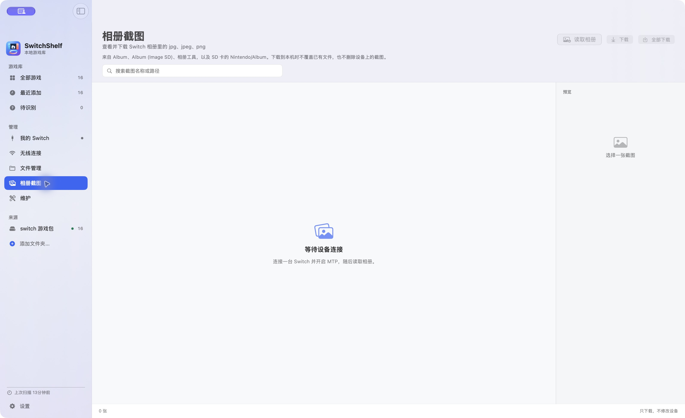

</details>

<details>
<summary>Maintenance and settings</summary>

Maintenance summarizes local games, sources, caches, staged installations, and scan issues. Settings provides startup scan options, local data access, and version information.

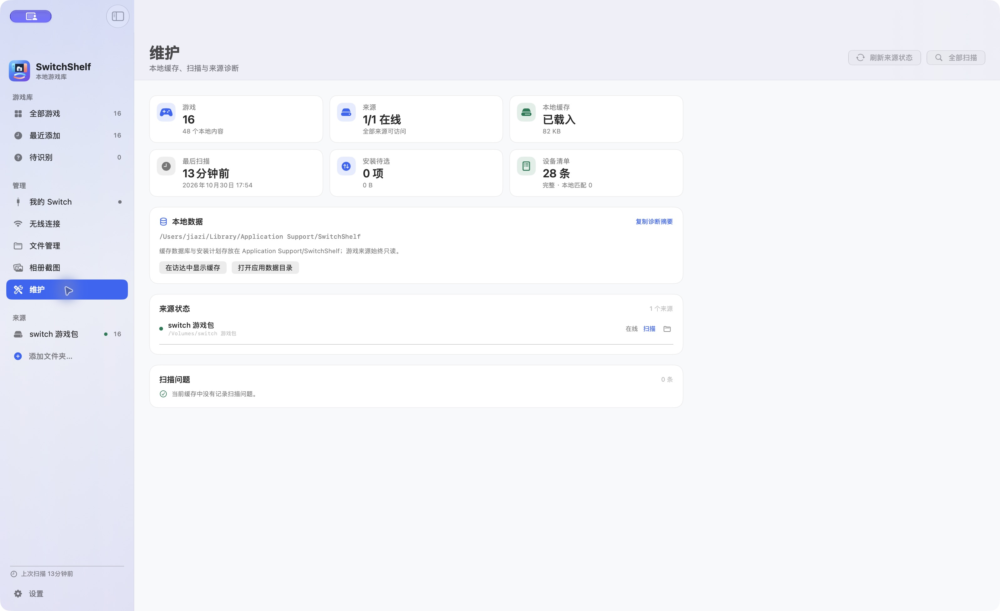

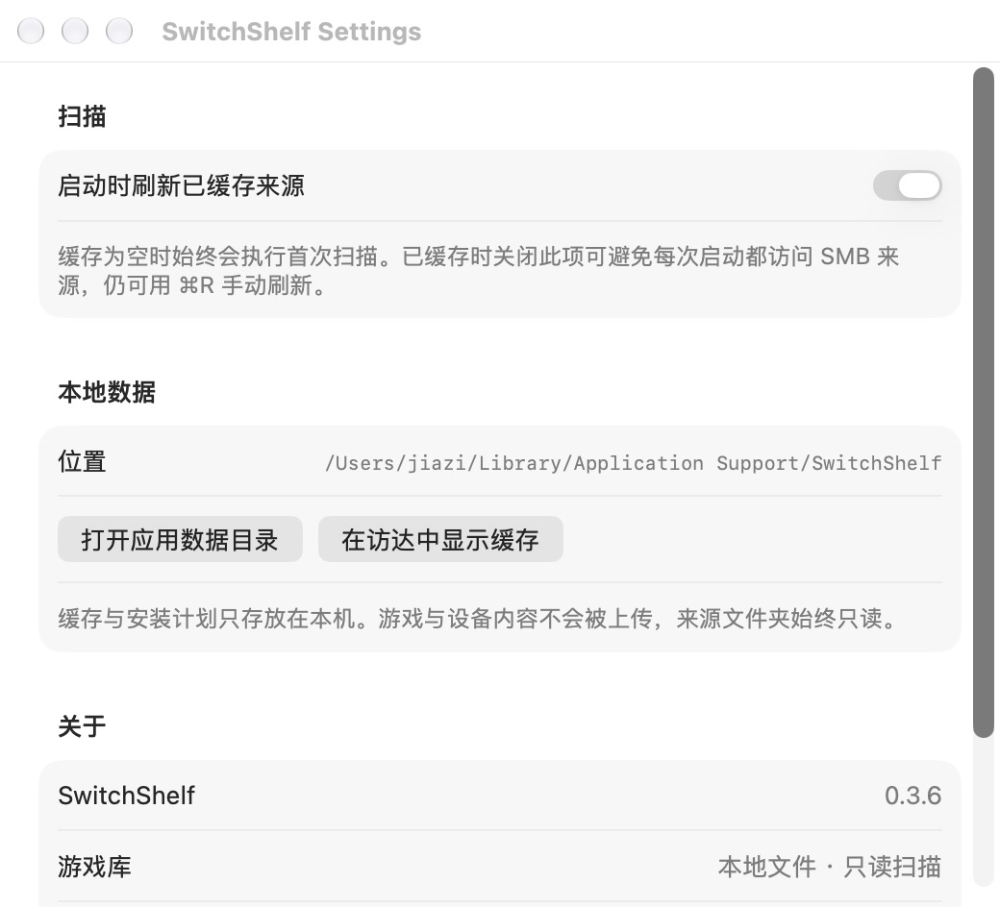

</details>

## Build and run

Requires macOS 26+, Apple Silicon, and Xcode / a Swift toolchain supporting Swift 6. The app packaging script also requires Python 3.

```sh
swift build
swift run SwitchShelf
```

Run offline tests, excluding the real NAS scan tests:

```sh
swift test --skip RealNASScanTests
```

Package a local app:

```sh
python3 scripts/build-app.py
```

The app is written to `build/SwitchShelf.app`. Device inventory, installation, and result verification all use libusb; the packaging script bundles the required runtime. ImageCaptureCore and libmtp connection routes have been removed.

## Usage

### Add library sources

Add a local folder or a mounted SMB/NAS share in the app. Scanning accesses source files read-only and retains cached entries when a source goes offline. Title IDs, content kinds, and raw versions parsed from filenames are matching candidates; they do not verify package contents.

### Read device inventory

1. Connect the Switch with a USB cable that supports data transfer.
2. Enable MTP and `Games` in sphaira, or start DBI's `Run MTP responder` with `Installed games` exposed.
3. Fully quit other MTP clients, including OpenMTP, and keep the device-side mode running.
4. Inspect the connection and read the inventory from SwitchShelf's device page.

USB detection, successful MTP communication, and inventory completeness are reported separately. The inventory reader traverses only recognized installed-content storages; it does not scan raw content, mounts, saves, installation, or speed-test storages. Historical caches and incomplete inventories cannot establish the device's current installation state.

### Install through sphaira

Click game cards to add them to installation staging, then select the base, update, and DLC files you want. Enter **MTP Install** in sphaira, choose the actual destination on the device, and start installation from the staging sidebar. The app's planned SD/NAND destination does not override device-side settings.

Files transfer serially while library sources remain read-only. A completed transfer needs independent inventory evidence before it can be marked installed. If sphaira's `Games` storage still shows cached data, refresh or reopen sphaira and manually read the inventory again without resending the files.

### Wireless connection

The wireless page is a separate DBI FTP client using file-access port `5000`; it refuses installation port `6000`. The current client performs read-only directory probing, and an FTP directory listing is not an installed-game inventory. USB discovery and installation pause while a wireless session is connecting or connected to avoid overlapping sessions. FTP validation currently covers fixtures and a local loopback server; a real Switch FTP session has not been accepted.

### Command-line diagnostics

Run only when the app and other MTP clients are not reading the device:

```sh
build/SwitchShelf.app/Contents/MacOS/switchshelf-probe inventory --transport libusb --timeout 90 --json
```

Exit code `2` means incomplete inventory coverage, not an empty or disconnected console. The `storages` subcommand lists storage descriptions without traversing games. Storage names describe reported capabilities and do not identify the server version or console environment.

## Development documentation and validation

A user-authorized Goose Game base/update reinstall and subsequent installation recognition have been recorded. See the [release review](Docs/Reports/release-review-2026-10-29.md) for the scope of that result, signing/distribution status, and remaining acceptance items. Coverage of other devices, versions, and SMB interruption scenarios depends on the relevant validation records.

The detailed development documents below are maintained in their existing languages.

- [Architecture](Docs/ARCHITECTURE.md) and [development plan](Docs/DEVELOPMENT_PLAN.md)
- [sphaira inventory acceptance](Docs/Reports/sphaira-inventory-acceptance-2026-10-25.md)
- [sphaira installation foundation](Docs/Reports/sphaira-mtp-install-foundation-2026-10-25.md) and [native MTP follow-up](Docs/Reports/native-sphaira-mtp-2026-10-25.md)
- [Installation staging design and validation](Docs/Reports/install-staging-redesign-2026-10-28.md)
- [Wireless FTP connection implementation](Docs/Reports/wifi-ftp-connection-2026-10-26.md)
- [Historical single-file installation test guide](Docs/Guides/sphaira-mtp-install-test.md) (an early development workflow; consult the architecture document for the current connection baseline)
- [Liquid Glass design reference](output/design-demos/03-liquid-glass.png) and [app icon concepts](Assets/AppIconConcepts)

The current app icon is concept 08, stored at `Assets/AppIcon.png`. The packaging script generates macOS ICNS sizes; use `--icon /absolute/path/to/selected.png` to select another PNG.

The repository retains the early USB Backend foundation. The current primary installation route is sphaira MTP; historical implementation details are available in the documents above.
