# SwitchShelf

**简体中文** | [English](README.en.md)

原生 macOS Switch 游戏库与设备管理工具，支持 sphaira MTP 安装、已安装内容清单、文件管理与相册截图。

A native macOS Switch library and device manager with sphaira MTP installation, installed-content inventory, file management, and screenshots.

使用 SwiftUI 构建，面向 macOS 26+ 与 Apple Silicon，采用原生 Liquid Glass 风格。应用界面目前以中文为主，本仓库提供中英文使用文档。

## 主要功能

- **游戏库**：扫描本地与已挂载的 SMB/NAS 目录，以网格或列表浏览封面、本体、更新和 DLC，支持搜索、筛选与排序。
- **安装待选**：累积安装计划，按文件选择本体、更新和 DLC，通过 sphaira MTP 串行传输，并独立核对安装结果。
- **设备与内容清单**：查看 USB 检测、MTP 存储入口与清单完整性，读取 sphaira `Games` 或 DBI `Installed games` 中的已安装内容。
- **文件管理**：浏览设备存储与目录，搜索、排序，并使用单文件上传与下载入口。
- **相册截图**：浏览、搜索、预览并下载设备相册图片。
- **无线与维护**：提供独立的 DBI FTP 连接页面，以及本地来源、缓存、扫描问题和设置管理。

## 界面截图

以下截图采集自 2026-10-30 正在运行的 SwitchShelf 0.3.6，展示主要工作界面。采集时 USB 与 FTP 均未连接，设备内容目录展示的是历史缓存，不代表设备当前安装状态。点击图片可查看原图。

**游戏库 · 网格视图** — 浏览游戏封面、内容类型与容量，通过搜索、筛选和排序定位游戏。

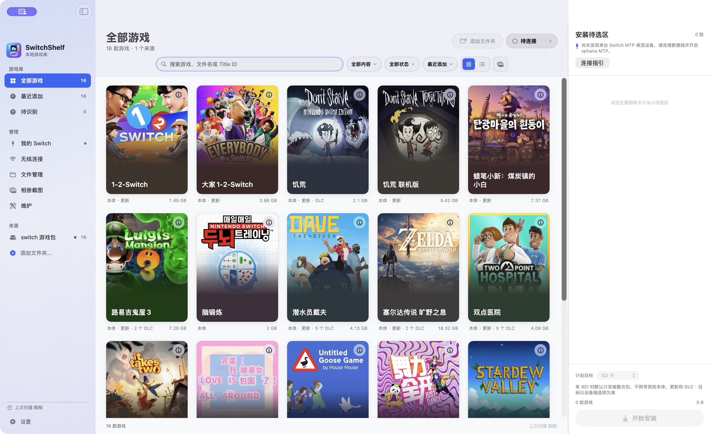

<details>
<summary>游戏库 · 列表视图</summary>

列表集中展示游戏名称、本体 / 更新 / DLC、文件数量、来源和容量。

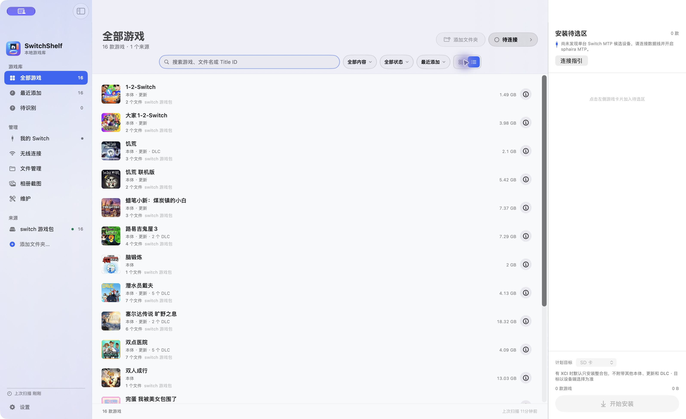

</details>

<details>
<summary>游戏详情与安装待选</summary>

详情浮层展示封面、匹配信息与安装状态依据；点击卡片可加入右侧待选区，展开选择本体、更新和 DLC，并查看计划目标与总容量。截图中的开始安装按钮因设备未连接而禁用。

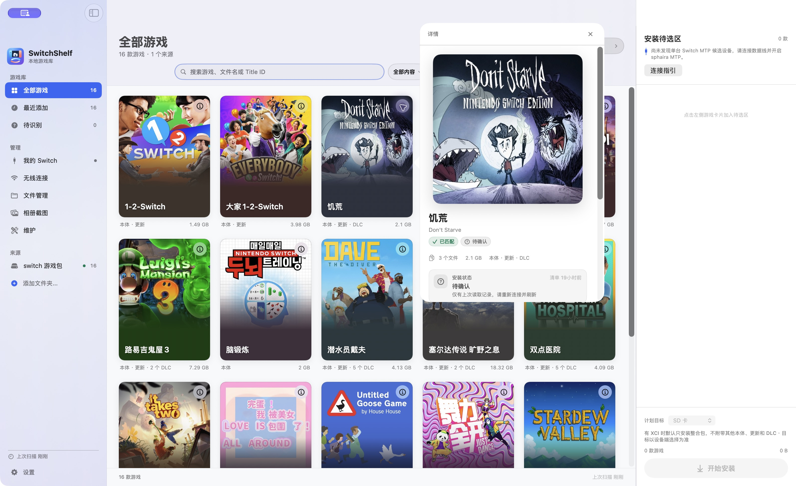

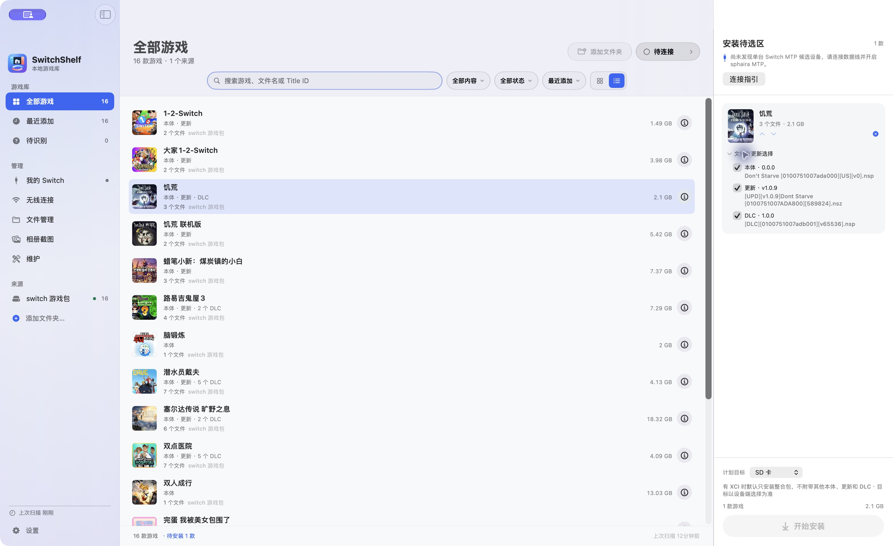

</details>

<details>
<summary>我的 Switch · 设备信息与内容目录</summary>

设备页展示 USB 检测、清单会话、存储入口及完整性信息；内容目录按游戏分组列出本体、更新和 DLC，支持搜索。以下为未连接设备时显示的历史清单。

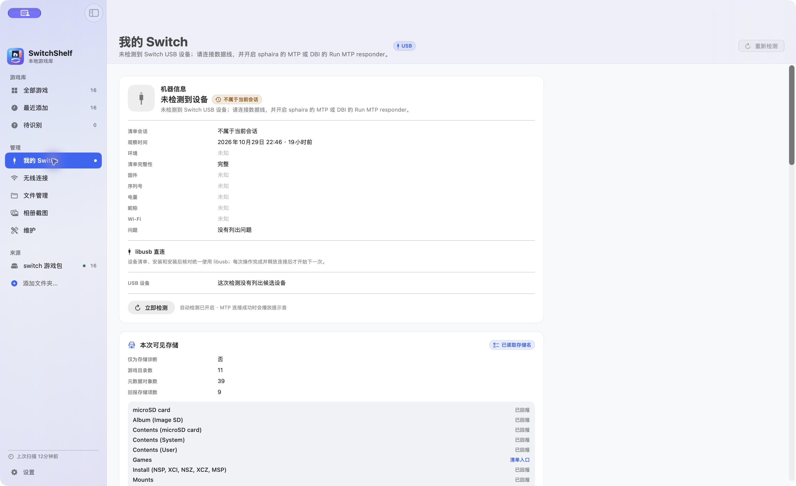

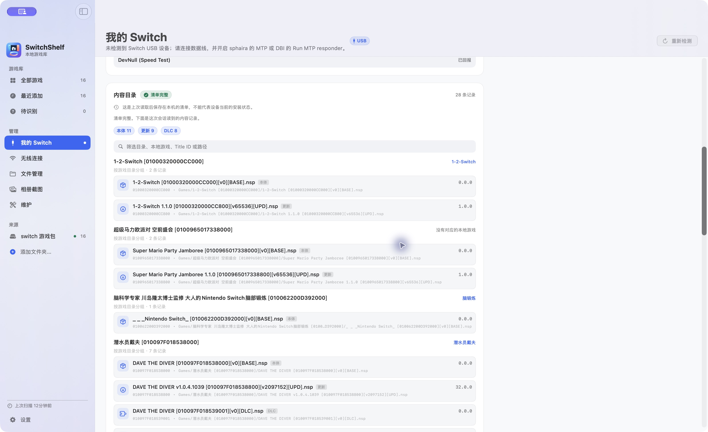

</details>

<details>
<summary>无线连接 · DBI FTP</summary>

填写主机与端口，查看连接指引和只读探测结果。截图为未连接状态。

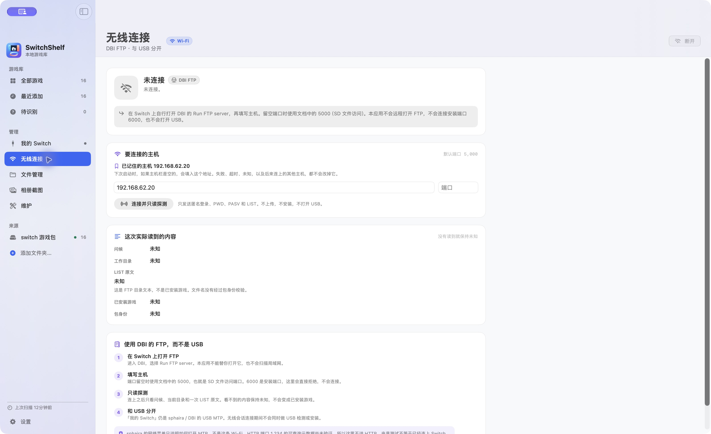

</details>

<details>
<summary>文件管理</summary>

设备存储、目录导航、搜索排序及单文件上传 / 下载入口。截图为等待设备连接状态。

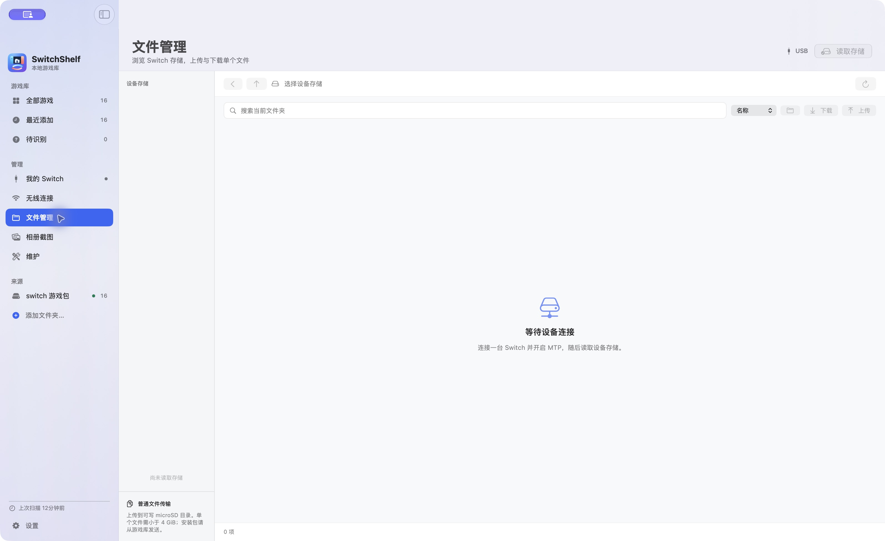

</details>

<details>
<summary>相册截图</summary>

相册搜索、图片预览与下载入口。截图为等待设备连接状态。

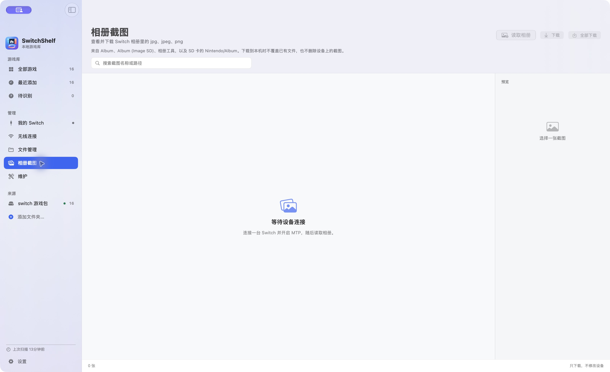

</details>

<details>
<summary>维护与设置</summary>

维护页汇总本地游戏、来源、缓存、安装待选和扫描问题；设置页提供启动扫描选项、本地数据入口与版本信息。

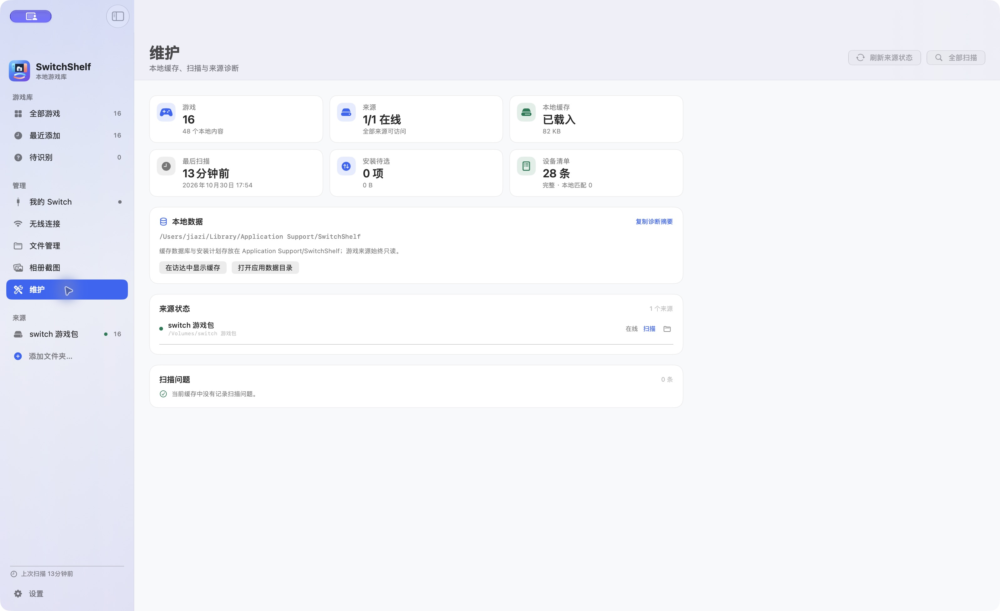

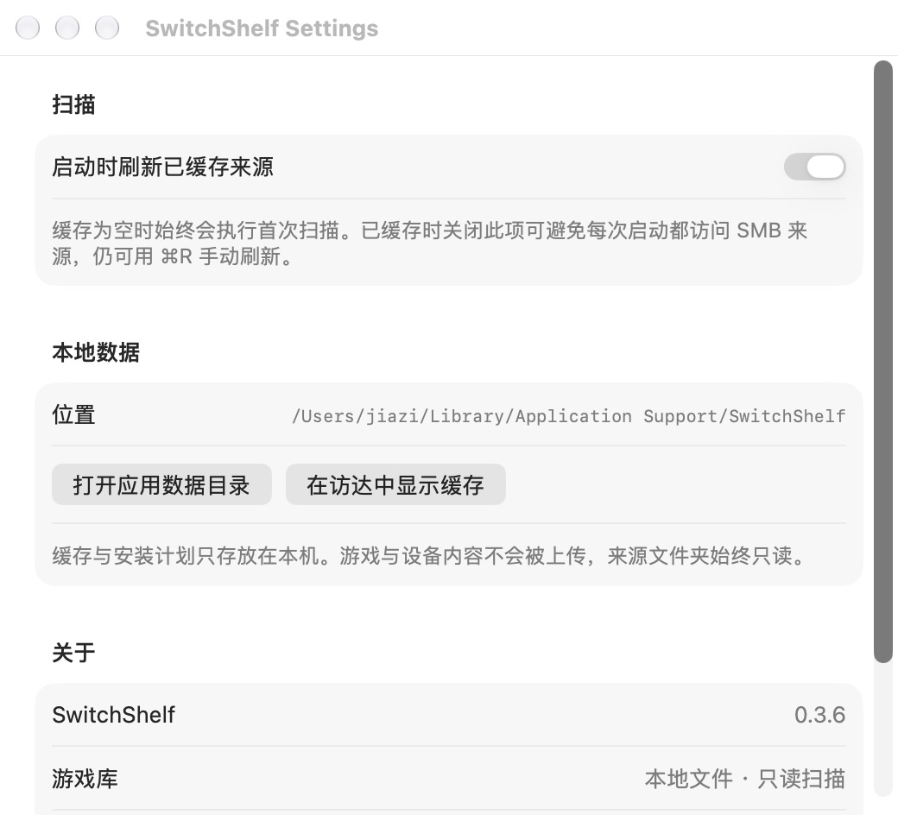

</details>

## 构建与运行

需要 macOS 26+、Apple Silicon，以及支持 Swift 6 的 Xcode / Swift 工具链；应用打包脚本使用 Python 3。

```sh
swift build
swift run SwitchShelf
```

运行离线测试（跳过真实 NAS 扫描测试）：

```sh
swift test --skip RealNASScanTests
```

打包本地应用：

```sh
python3 scripts/build-app.py
```

产物位于 `build/SwitchShelf.app`。设备清单、安装与结果核对统一使用 libusb，打包脚本会将所需运行库包含在应用内。ImageCaptureCore 与 libmtp 连接路径已移除。

## 使用说明

### 添加游戏来源

在应用中添加本地目录或已挂载的 SMB/NAS 目录。扫描只读访问来源，来源离线时保留已有缓存。文件名解析出的 Title ID、内容类型与原始版本号用于候选匹配，不代表已验证安装包内容。

### 读取设备清单

1. 使用支持数据传输的 USB 线连接 Switch。
2. 在 sphaira 中启用 MTP 与 `Games` 存储，或在 DBI 中启动 `Run MTP responder` 并开放 `Installed games`。
3. 完全退出 OpenMTP 等其他 MTP 客户端，保持设备端模式运行。
4. 在 SwitchShelf 设备页查看连接情况并读取清单。

USB 检测、MTP 通信成功和清单完整性分别显示。清单读取只遍历认可的已安装内容存储，不扫描原始内容、挂载、存档、安装或测速存储。历史缓存与不完整清单均不能证明设备当前安装状态。

### 通过 sphaira 安装

在游戏库中点击卡片加入安装待选区，选择需要的本体、更新与 DLC。在 sphaira 中进入 **MTP Install**，在设备端选择实际安装目标，再从待选区启动安装。应用中的 SD/NAND 计划目标不会替代设备端设置。

文件按顺序传输，游戏来源保持只读。传输完成后需要独立清单证据才能标记为已安装；如果 sphaira 的 `Games` 仍显示缓存，可刷新或重新打开 sphaira 后手动重新读取清单，无需再次发送文件。

### 无线连接

“无线连接”页是独立的 DBI FTP 客户端，使用文件访问端口 `5000`，拒绝连接安装端口 `6000`。当前客户端用于只读目录探测，FTP 目录列表不构成已安装游戏清单。无线会话连接中或已连接时，USB 发现和安装暂停，避免会话重叠。FTP 验证目前覆盖测试夹具与本机回环服务器，尚无真实 Switch 会话验收。

### 命令行诊断

仅在应用及其他 MTP 客户端均未读取设备时运行：

```sh
build/SwitchShelf.app/Contents/MacOS/switchshelf-probe inventory --transport libusb --timeout 90 --json
```

退出码 `2` 表示清单覆盖不完整，不能解读为空设备或设备未连接。`storages` 子命令只列出存储描述，不遍历游戏。存储名称表示设备报告的能力，不能据此确定服务器版本或主机环境。

## 开发文档与验证记录

已记录一次经用户授权的 Goose Game 本体 / 更新重装及安装后识别；该结果的适用范围、签名分发与其他待验收项见[发布检查报告](Docs/Reports/release-review-2026-10-29.md)。其他设备、版本和 SMB 中断场景的覆盖以对应验证记录为准。

- [实现架构](Docs/ARCHITECTURE.md)与[开发计划](Docs/DEVELOPMENT_PLAN.md)
- [sphaira 清单验证](Docs/Reports/sphaira-inventory-acceptance-2026-10-25.md)
- [sphaira 安装基础实现](Docs/Reports/sphaira-mtp-install-foundation-2026-10-25.md)与[原生 MTP 跟进](Docs/Reports/native-sphaira-mtp-2026-10-25.md)
- [安装待选区设计与验证](Docs/Reports/install-staging-redesign-2026-10-28.md)
- [无线 FTP 连接实现](Docs/Reports/wifi-ftp-connection-2026-10-26.md)
- [历史单文件安装测试指引](Docs/Guides/sphaira-mtp-install-test.md)（早期开发流程，当前连接基线以架构文档为准）
- [Liquid Glass 设计参考](output/design-demos/03-liquid-glass.png)与[应用图标方案](Assets/AppIconConcepts)

当前应用图标为方案 08，源图位于 `Assets/AppIcon.png`。打包脚本生成 macOS ICNS；可通过 `--icon /absolute/path/to/selected.png` 指定其他 PNG。

USB Backend 的早期基础实现保留在仓库中，当前主要安装路径为 sphaira MTP。历史开发记录见上述文档。
