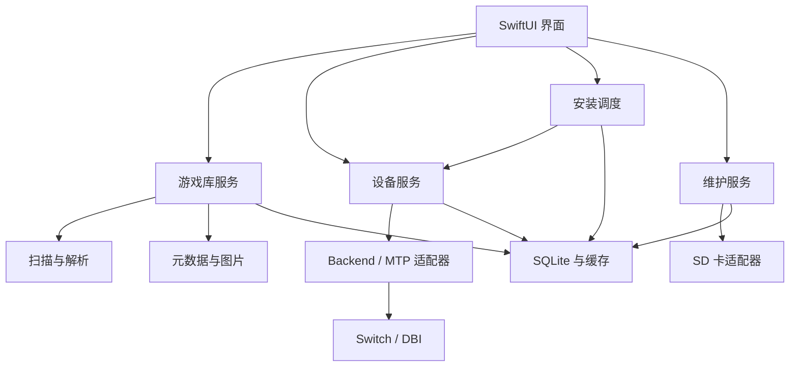

# SwitchShelf macOS 原生应用开发文档

- 文档版本：v1.2
- 日期：2026-10-22
- 状态：开发设计基线，通信能力等待实机验证
- 项目名称：SwitchShelf（暂定）
- 目标平台：Apple Silicon Mac，首版以 macOS 26 为基线
- 首个验证环境：Mac mini M4 + 已运行 Atmosphère 的 Switch 长续航版 + DBI
- 文档用途：产品需求、技术设计、任务拆分和验收依据

> 本文整合游戏库、封面与元数据、批量安装、设备连接与基础信息、大气层维护需求。推荐方案与已经证实的上游能力分开描述；未经协议和实机验证的能力不作为首版承诺。本文不是已经完成的实现或兼容性报告。

## 1. 产品目标

打造具有 macOS 26 原生视觉体验的 Switch 游戏库与安装管理工具。用户选择本地文件夹后，应用自动扫描文件、识别游戏并展示封面与资料，支持选择本体、更新和 DLC 排队安装；同时常驻展示 Switch 连接状态，并提供设备信息与独立的维护流程。

### 1.1 主要用户流程

1. 添加游戏所在文件夹。
2. 后台扫描，先展示发现结果，再补充精确识别和封面。
3. 校正待确认条目，浏览游戏详情。
4. 选择需要的本体、更新和 DLC，生成安装计划。
5. 连接 Switch，并在 DBI 中选择与应用一致的通信模式。
6. 完成握手后执行安装队列。
7. 查看传输、安装结果与历史记录。
8. 需要维护时，进入独立维护页面，连接可写 SD 卡并生成升级计划。

### 1.2 产品原则

- 本地优先：索引、任务、设备档案与缓存保存在本机。
- 原文件默认只读：扫描不移动、重命名或删除用户游戏文件。
- 身份优先：使用内容元数据和 Title ID 识别，名称只作线索。
- 状态真实：传输结束与设备安装成功分别记录。
- 渐进增强：信息无法读取时显示未知或不支持，不编造数据。
- 无需账号与自建服务器；首版不引入大模型。
- 面向用户有权使用的本地内容；应用不承担游戏资源下载功能。

## 2. 范围与优先级

| 优先级 | 功能 | 版本定位 |
| --- | --- | --- |
| P0 | 多文件夹扫描、增量索引、离线目录保留 | MVP |
| P0 | 游戏识别、人工纠正、封面及资料缓存 | MVP |
| P0 | 本体、更新、DLC 分组及版本展示 | MVP |
| P0 | USB 发现、连接状态、模式指引、设备档案 | MVP |
| P0 | 单设备顺序安装队列、历史、异常恢复 | MVP |
| P0 | macOS 原生界面、搜索、筛选、多选 | MVP |
| P1 | 存储信息、已安装内容读取 | 按协议验证结果启用 |
| P1 | SD 卡组件识别、维护计划、备份与文件升级 | 维护版本 |
| P1 | MTP 兼容通道 | Backend 稳定后评估 |
| P2 | 网络安装、多设备管理、配套 Switch 程序 | 后续版本 |
| P2 | 系统固件升级辅助 | 独立立项与验证 |

MVP 不承诺：任意文件百分之百识别、断点续装、所有设备信息自动读取、全自动运行环境升级或运行中覆盖系统组件。

## 3. 页面、前端设计风格与视觉规范

### 3.1 信息架构

侧边栏：全部游戏、最近添加、待识别、安装队列、我的 Switch、维护、文件夹、设置。

主窗口建议初始尺寸约 1280 × 820pt，侧边栏约 210pt，可选检查器约 320pt，中间内容区自适应。窄窗口隐藏检查器，通过详情页展示信息。

使用 SwiftUI 标准导航、工具栏、搜索框和检查器，必要时用 AppKit 补充。Liquid Glass 用于导航及浮动控件，封面、列表和正文保持清晰。支持系统深浅色、减少透明度、减少动态效果、VoiceOver 和键盘操作。

### 3.2 游戏库

- 默认封面网格，可切换紧凑列表。
- 竖版卡片建议 2:3，支持调整尺寸。
- 卡片展示名称、本体/更新/DLC 概况、目标设备安装标识及识别或任务状态。
- 支持多选、右键加入队列、在 Finder 显示、刷新资料、纠正匹配。
- 搜索支持中文名、原文名、Title ID、文件名。
- 筛选支持内容类型、识别状态、文件来源、在线状态，以及目标设备的已安装、未安装、部分安装、未知状态。
- 支持按名称、添加时间、文件总大小排序。
- 无竖版海报时使用完整方形图标配背景和标题，不拉伸素材。

### 3.3 游戏详情

顶部：封面、背景、中文名称、原文名、简介和加入队列按钮。

| 区域 | 内容 |
| --- | --- |
| 概览 | 开发商、发行商、发行日期、类型、游戏语言 |
| 本地内容 | 本体、更新、DLC、重复候选、路径和大小 |
| 安装 | 内容选择、依赖、目标位置、空间提示 |
| 技术信息 | Title ID、原始版本、元数据来源、解析与匹配状态 |

中文简介与游戏是否支持中文分别显示。技术字段默认折叠，避免干扰日常安装。

### 3.4 安装中心

按游戏分组，每组显示本体、所选更新及 DLC。顶部显示目标设备、总进度、速度、预计时间。任务可排序、移除未开始项、完成当前文件后暂停、重试失败项。日志默认折叠。

### 3.5 设备入口

右上角常驻设备按钮，例如“我的 Switch · 已就绪”，副标题展示通道。点击展开简要信息、重新连接和连接帮助；完整信息位于“我的 Switch”页面。

### 3.6 必须设计的空状态

首次未添加目录、扫描中、无匹配结果、文件离线、元数据网络失败、没有设备、设备模式错误、USB 被占用、队列为空、安装结果未知。每种状态提供具体下一步。

### 3.7 前端设计方向

前端指 macOS 原生应用的界面与交互层，以 SwiftUI 实现。整体风格为**原生、克制、以游戏封面为视觉中心**：游戏库具有收藏陈列感，安装和维护页面强调信息清晰、状态可信与操作可控。

- **内容优先**：封面是主要彩色元素，背景、导航和工具栏保持中性；不用大面积品牌色抢占内容注意力。
- **层级清楚**：通过字号、字重、留白和表面层次区分内容，减少厚重边框、重复卡片和多层阴影。
- **原生一致**：导航、菜单、弹窗、文件选择与设置优先使用系统组件；自定义样式集中在封面卡片、设备摘要和任务进度。
- **适度通透**：Liquid Glass 仅用于适合的导航与浮动操作区域；游戏资料、数据表格、进度和错误说明使用稳定、易读的内容表面。
- **操作聚焦**：每个任务区域设置一个主要操作；次要操作使用普通按钮、菜单或右键入口。维护写入、移除来源等操作使用明确动词说明对象与后果。

### 3.8 配色与表面层级

默认跟随系统深浅色与强调色；设置中可选择浅色、深色或跟随系统。颜色通过语义资源统一定义，不在业务视图中散落硬编码色值。

| 语义 | 设计约定 | 使用位置 |
| --- | --- | --- |
| 窗口底色 `surface.window` | 系统窗口背景色，保持低干扰 | 主窗口与内容画布 |
| 内容表面 `surface.content` | 与底色轻微区分的中性表面 | 详情分组、任务行、信息卡 |
| 导航材质 `surface.navigation` | 采用系统提供的导航材质与层级 | 侧边栏、工具栏、浮动控件 |
| 主文字 `text.primary` | 系统主要文字色 | 名称、关键数值、操作标题 |
| 次文字 `text.secondary` | 系统次要文字色 | 开发商、路径摘要、更新时间 |
| 分隔 `separator` | 低对比细线，必要时使用 | 列表行、内容分组边界 |
| 强调 `accent` | 跟随系统强调色 | 主按钮、选中态、焦点与活动进度 |
| 状态色 `status.*` | 成功绿、提醒橙、错误红；未知使用中性色 | 设备状态、识别结果、任务结果 |

状态色始终配合图标与文字；“传输完成，待设备确认”使用待确认样式，不能使用表示安装成功的绿色勾号。离线与未知状态保留可读对比度，不能仅降低整个条目的透明度。

封面背景图可在详情顶部局部使用，并通过遮罩与独立文字表面保障可读性；不将动态封面取色用作全窗口背景。深色模式单独校准表面与分隔线，不对浅色界面直接反色。开启减少透明度时，将材质替换为不透明的语义背景。

### 3.9 字体、尺寸与布局基准

字体采用系统字体及中文回退字体。标题使用适度加粗，正文以常规字重为主；不引入装饰字体。Title ID、版本和速度等技术或变化数值按需使用等宽字体或等宽数字。

以下尺寸为应用自定义内容的初始设计值，单位为 pt；系统控件保留原生尺寸，辅助功能与内容增长时允许布局扩展。

| 项目 | 初始设计值 | 使用规则 |
| --- | --- | --- |
| 页面标题 | 24～28，semibold | 游戏详情与独立页面标题 |
| 区域标题 | 16～18，semibold | 本地内容、安装选择、设备信息 |
| 正文与控件说明 | 13～14 | 列表、介绍、操作说明 |
| 辅助文字 | 11～12 | 来源、时间、非关键技术字段；关键信息不使用此层级 |
| 间距序列 | 4 / 8 / 12 / 16 / 24 / 32 | 图标与文字 4～8，组件内部 12～16，区域之间 24～32 |
| 内容区留白 | 常规 24，窄窗口 16 | 页面左右留白保持一致 |
| 封面网格 | 封面宽 144～200，列间距 16～24 | 默认封面宽约 168，按可用宽度自动排列 |
| 自定义圆角 | 小元素 8，卡片 12，大型分组 16 | 系统按钮、菜单和弹窗沿用系统外观 |
| 列表行 | 紧凑约 44，含双行摘要约 60 | 长名称或辅助功能需要时增高 |

窗口以 1280 × 820 为设计基准，首版建议最小尺寸 960 × 640。侧边栏初始宽度约 210，可在约 180～260 范围内调整；检查器初始宽度约 320。上述尺寸为布局起点，不限制系统文字与控件的正常展示。

宽度不足以同时容纳侧边栏、主内容和检查器时，优先收起检查器；继续缩窄时允许折叠侧边栏。封面网格减少列数，详情双栏改为单栏，不通过持续缩小文字来适配。搜索、设备入口和主要操作保持可达，低频工具栏操作可收进菜单。

### 3.10 核心组件样式与交互

| 组件 | 视觉与行为约定 |
| --- | --- |
| 侧边栏 | 图标配文字，按游戏库、任务与设备、来源分组；计数仅用于待识别或队列等有行动意义的项目 |
| 工具栏 | 页面标题、搜索、筛选/排序、视图切换与设备入口分区排列；图标按钮提供提示文字与辅助功能名称 |
| 游戏卡片 | 2:3 封面、下方两行以内名称及一行内容摘要；状态徽标少量展示，多余信息进入详情或检查器 |
| 紧凑列表 | 名称与缩略图为主列，内容类型、版本、大小和状态对齐；列宽可调整，长路径进入详情查看 |
| 内容标签 | “本体”“更新”“DLC”采用低强调度标签；“待确认”“文件离线”等状态配文字与图标，避免与内容类型混淆 |
| 设备状态按钮 | 图标、状态文字与通道摘要组成稳定布局；重连时局部显示活动指示，不让整个工具栏跳动 |
| 任务行 | 展示游戏、当前文件、阶段、进度与可执行操作；字节进度、等待回执和最终结果使用不同文案 |
| 空状态 | 使用简洁 SF Symbols、标题、一句原因和主要操作；如“添加游戏文件夹”“查看连接步骤”“重试资料获取” |

封面图片保持比例、统一裁切策略并异步加载；有方形素材时按 3.2 的回退方案展示。加载占位沿用卡片尺寸，图片就绪后不改变网格高度；不在加载前短暂显示错误或“无法识别”。

卡片和列表项至少定义默认、悬停、键盘焦点、选中、不可操作与异常状态。选中态使用强调色描边或底色，并支持区分窗口失焦状态；悬停变化保持轻微，不依赖放大卡片表达交互。异常条目仍可打开详情和执行恢复操作。

点击选中，双击或选中后按 Return 打开详情；Command 点击增减选择，Shift 点击连续选择。右键菜单与工具栏提供一致的操作，不能把主要功能只藏在悬停或右键中。多选后显示已选数量及“加入队列”等批量操作，范围含糊时先显示安装计划。

按钮文案明确区分“加入队列”和“开始安装”。禁用动作在附近说明原因，例如“连接设备并完成握手后可开始”；不只显示一个无法点击的按钮。可恢复反馈放在相关区域，阻断错误使用明确对话框；后台扫描和资料刷新不反复弹窗。

### 3.11 页面气质与动效

- **游戏库**：封面陈列为主，首屏保留较多内容空间；扫描进度放在轻量状态区域，不遮挡已入库游戏。
- **游戏详情**：顶部用封面、名称和主要操作建立重点，下方按概览、本地内容、安装组织；技术信息默认折叠。背景图缺失时仍保留完整布局。
- **安装中心**：以任务列表和明确进度为主；总传输与当前文件进度分开，等待设备回执时使用阶段提示，不把传输百分比解释为安装成功。
- **我的 Switch**：连接状态优先，容量和版本分组展示；历史数据直接标注“上次读取”及时间，未知字段保留说明。
- **维护页面**：使用步骤、差异列表和检查结果组织内容；写入按钮明确标注目标 SD 卡及操作，执行前展示变更与备份结果。

自定义悬停和状态切换动效建议约 120～180ms，面板展开与内容切换约 180～240ms；系统组件沿用系统动效。避免弹跳、封面持续漂浮、循环发光和大范围视差。开启减少动态效果时取消缩放与位移动画，只保留必要的即时状态反馈或轻微淡入淡出。

实际进度由任务事件驱动，不以动画制造持续推进；无法获得总量时使用不确定进度，并说明当前阶段。扫描、传输和错误更新不得抢走键盘焦点。

### 3.12 前端实现交付要求

在 `Resources` 中维护语义颜色与图片资源，在界面公共层集中维护字体、间距、圆角等设计值。优先复用原生组件，自定义封面卡片、状态徽标、设备按钮和任务行保持统一接口与外观。

界面开发使用模拟数据覆盖长中英文名称、缺图、超大容量、未知版本、设备断开及部分任务失败等状态。每个主要页面提供深浅色、最小窗口与常规窗口预览；模拟展示状态不代表设备能力已经验证。

### 3.13 已安装与未安装标识

游戏库按当前目标 Switch 及本次连接所处的系统环境展示安装标识。以设备实际清单为判断依据，本 App 的安装历史单独展示；其他工具安装的内容也应在设备清单同步后参与匹配。

| 标识 | 判断规则 | 视觉约定 |
| --- | --- | --- |
| 已安装 | 设备确认存在本体；没有已确认的本地内容缺项时使用 | 绿色勾号与“已安装”文字 |
| 未安装 | 完整且有效的设备清单确认该游戏本体、更新和 DLC 均不存在 | 中性色下载图标与“未安装”文字 |
| 部分安装 | 已确认存在部分内容，同时确认缺少本体、可比的本地更新或部分本地 DLC | 橙色分段图标与“部分安装”文字；详情说明缺项 |
| 未知 | 尚未读取、清单不完整、无法可靠匹配，或当前模式不提供查询 | 中性色问号与“未知”文字，提供原因与刷新入口 |

卡片封面角落显示一个紧凑的安装徽标，列表视图提供安装状态列。右侧检查器和详情按本体、更新、DLC 分项展示，例如“本体已安装”“设备 v1.1 / 本地 v1.2”“DLC 已安装 2/3”。版本不可比较或 DLC 清单不完整时不计算差额；可以显示“本体已安装，更新/DLC 未知”，不能暗示内容已全部齐备。

“已安装”表示确认本体存在，不保证游戏能够正常启动，也不表示安装了所有已发行 DLC。对照集合使用本地可识别的本体、最高可比更新和各 DLC，重复文件或旧更新副本不算缺项；版本比较沿用 5.3。仅装有更新或 DLC 时明确提示“缺少本体”。

断开连接后使用“上次读取：已安装”等历史文案并附时间；切换设备、无法确认设备身份或切换系统环境时不得沿用为当前结果。设备未返回某条内容，只有在查询范围完整且有效时才可判定其未安装。查询失败或缺少 Installed games 存储不能当作空清单。

## 4. 扫描与文件索引

### 4.1 文件来源

支持用户授权的本地文件夹、外置磁盘与已挂载的 NAS 目录。首版使用系统选择器添加，不扫描用户未授权的整盘。目录访问策略应结合沙盒决策；启用 App Sandbox 时使用 security-scoped bookmarks 保存授权。

### 4.2 扫描流水线

1. 枚举：收集路径、卷身份、文件身份、大小和修改时间。
2. 稳定性检查：跳过仍在复制、临时或不可读文件。
3. 快速索引：根据扩展名、文件名和已有记录建立候选。
4. 深度解析：按格式读取容器及可访问的内容元数据。
5. 归档：关联游戏、发行、内容与实际文件。
6. 补全：异步请求名称、简介及图片。
7. 保存检查点：允许取消、重启后继续未完成任务。

支持识别 NSP、XCI、NSZ、XCZ，但分别记录索引、解析、安装三个能力。压缩格式应有独立样本验证；首版不自动解压或重压缩原文件。

### 4.3 增量与异常

- FSEvents 触发增量处理；启动及手动操作进行一致性核对。
- 事件可能合并或遗漏，不能将事件流当作完整事实。
- 文件未变化时复用解析结果；解析器升级后可指定重新解析。
- 外置卷或 NAS 不在线时标记离线，不删除记录。
- 文件移动优先用卷及文件身份重新关联；无法确定则人工定位。
- 默认不跟随目录外符号链接，避免递归与越界扫描。
- 元数据失败不阻塞文件入库。
- 不在首次扫描对全部大文件做完整哈希；先快速指纹，按需执行完整校验。
- 快速指纹相同只代表重复候选，不能据此自动删文件。

## 5. 游戏识别、归档与元数据

### 5.1 识别证据

优先采用包内可验证元数据与明确 ID；文件名和模糊名称只用于候选。用户确认的映射作为独立覆盖层，不被自动刷新抹掉。强证据与用户映射冲突时提示复核。

| 状态 | 定义 |
| --- | --- |
| 已验证 | 内容元数据与外部记录一致 |
| 已匹配 | 根据明确 ID 匹配，内容尚未验证 |
| 待确认 | 主要依赖名称或存在冲突 |
| 无法识别 | 信息不足、格式不支持或解析失败 |

加密内容的深度解析可能需要用户提供相应密钥。密钥缺失或版本不匹配应返回结构化错误，应用继续支持快速索引与人工匹配。密钥不随应用分发、不上传，不进入日志或崩溃附件。

### 5.2 分组规则

Game 表示展示条目，Release 表示具体发行，Content 表示本体/更新/DLC，PackageFile 表示物理文件。一个文件可包含多个内容，同一内容也可有不同文件副本。

- 按内容关系归并，避免按名称合并不同地区发行。
- DLC 优先按明确关系归属，不只靠名称或 ID 算术推断。
- 保留全部更新版本，默认建议选择最高兼容候选，不自动删除旧文件。
- 多内容整合包只有在解析及通道支持选择时才允许包内内容级操作，否则以整个包为安装单位。
- 用户可纠正名称、封面、发行和归属；变更有本地记录。

### 5.3 版本语义

分别保存原始内容版本、显示版本、本地最高版本、设备读取版本、在线已知版本。比较必须基于同一内容和可比较的版本语义。没有可靠在线记录时显示未知，不显示最新版；显示版本不可随意从原始整数换算。

### 5.4 元数据提供者

设计可替换 MetadataProvider。TitleDB 为候选 ID 和地区语言数据源；封面与介绍按来源能力补充。保存来源、远端标识、语言、获取时间和匹配依据。不同来源 ID 需要显式映射。

图片缓存原始资料与适配缩略图，设置磁盘上限与淘汰策略。用户自定义素材不随普通缓存清理删除。离线仍可浏览已有数据；检查每个来源的数据和图片使用条件。

## 6. 设备连接与基础信息（P0）

### 6.1 连接状态机

| 状态 | 说明 | 行为 |
| --- | --- | --- |
| disconnected | 未检测到目标 | 可整理和排队 |
| detected | 发现候选 USB 设备 | 尝试确认通道 |
| waitingForMode | 模式不符或等待进入 | 展示 DBI 操作指引 |
| connecting | 正在握手 | 禁止启动安装 |
| ready | 通道握手完成 | 可启动支持的任务 |
| busy | 正在执行任务 | 可继续加入队列 |
| reconnecting | 会话丢失，等待恢复 | 保留任务 |
| error | 权限、占用、超时等异常 | 给出操作建议 |

设备枚举成功不等于可安装。模式不能可靠识别时显示“无法确认，请检查 DBI 模式”，不要给出确定但错误的诊断。状态使用文字与图标，不只靠颜色。

### 6.2 设备详情字段

| 字段 | 获取策略 | 不可用时 |
| --- | --- | --- |
| 自定义名称 | 用户设置 | 默认 Switch |
| 型号 | 可靠设备数据或手动设置 | 未知，允许填写 |
| 连接通道与模式 | 当前会话 | 断开或待确认 |
| 最近连接时间 | 本机记录 | 尚未连接 |
| USB 链路速率 | USB API 可提供时读取 | 不展示数值 |
| 实际传输速度 | 任务字节统计 | 空闲时不展示实时值 |
| microSD/系统容量 | 通道能力验证后读取 | 当前模式未提供 |
| 系统/Atmosphère/DBI 版本 | 已验证接口、SD 卡或手动来源 | 未知 |
| Hekate 版本 | SD 卡或其他可靠来源 | 未知 |
| sysMMC/emuMMC 环境 | 可靠运行时数据 | 无法确认 |
| 已安装内容 | 已验证设备查询 | 仅展示本 App 历史 |

SD 卡中的文件版本不等于当前运行版本；启动配置也不等于当前正在运行的环境。每个字段附来源、获取时间及 freshness 状态。断开后保留快照，明确标注“上次读取”。

型号不能仅从通用 USB 标识推断。设备档案可记录用户这台“Switch 长续航版”，标注为手动设置。

### 6.3 能力协商

DeviceCapabilities 至少区分：canInstall、canReadStorage、canReadInstalledContents、canReadRuntimeInfo、canConfirmInstallResult、canCancelCurrent、canResumeTransfer。默认未知或不支持，经过适配器和版本验证再启用。

不同 DBI 模式能力独立，不能沿用上一次模式的权限或数据。未知能力不阻塞其他已经验证的功能。

### 6.4 设备身份与恢复

USB 地址不是长期身份。优先采用通道提供且经过验证的稳定标识；若没有，使用本地档案并要求用户确认，不能宣称已自动识别同一台设备。序列号若可获得则默认遮挡，日志脱敏。

重连必须重新握手，默认由用户点击继续队列；目标无法确认时禁止自动继续。首版只支持一台活动设备，其他设备连接时提示选择。

### 6.5 刷新策略

插拔事件驱动发现；握手后按能力刷新信息。安装期间优先传输，不并发发出可能干扰 USB 会话的查询。存储数据在安装前和安装后刷新；不能读取时提供明确提示。健康监测使用协议允许的机制，避免自造心跳破坏会话。

### 6.6 DBI 已安装清单读取方案

截至 2026-10-22 的上游资料核对，参考提交为 `22090afc64cc7b5d645a99bf3d4d8625a67b766e`：

- [DBI 官方 MTP 文档](https://github.com/rashevskyv/dbi/blob/22090afc64cc7b5d645a99bf3d4d8625a67b766e/README.md#run-mtp-responder)说明，`Run MTP responder` 模式的 `4: Installed games` 展示内置 NAND 与 SD 卡中的已安装游戏，并提供本体、更新和 DLC 的虚拟文件。此处是设备内容视图，不是本 App 的安装历史。
- [官方配置](https://github.com/rashevskyv/dbi/blob/22090afc64cc7b5d645a99bf3d4d8625a67b766e/dbi.config)提供 `4: Installed games=true` 开关；该存储可能被配置为隐藏，不能将缺少该入口解释为没有安装游戏。
- [公开 dbibackend 脚本](https://github.com/rashevskyv/dbi/blob/22090afc64cc7b5d645a99bf3d4d8625a67b766e/dbibackend)处理安装文件列表、文件分段读取与退出；其中的文件列表来自电脑上待安装的文件，没有实现查询设备已安装清单。不能将其 `LIST` 命令当作设备游戏列表。

实现方案：先开发只读 MTP 清单原型，枚举 Installed games 中的游戏目录、分项内容及对象属性，与本地库的可靠身份数据匹配。只枚举目录和必要信息，不复制完整游戏文件；Title ID、版本、内容类型可从哪些对象属性或命名中可靠取得，需要按目标 DBI 版本实测，不预设存在结构化清单 API。名称只能作匹配线索，合并包与分项内容需要去重。

MTP 清单读取适配器可与 Backend 安装适配器分别实现，读取能力的验证不必等待 MTP 安装通道完成。若安装仍走 Backend，则流程为“MTP 同步设备清单→用户切换 Backend→安装→需要复核时切回 MTP 刷新”。不假设两种模式可同时占用同一 USB 会话。MTP 同时承担安装与清单读取的方案另行验证。

设备清单只代表本次启动环境可见的内容。sysMMC 与 emuMMC 分开记录；无法确认环境时绑定到当前会话并注明环境未确认，重连后重新核对。清单读取的上游设计已有文档依据，但 macOS 客户端兼容性、字段可靠性、完整性和刷新行为仍需用户实机验证，通过后才启用相应的 `canReadInstalledContents` 能力。

## 7. 安装通信与队列

### 7.1 通道决策

优先验证 DBI Backend 安装，经 libusb 封装；MTP 安装为后续兼容适配器，只读清单查询可按 6.6 提前验证。两者模式不同，连接向导必须给出相应 DBI 菜单提示。用户目前在 MTP 界面，若切换 Backend 需明确引导。

官方 dbibackend 作为协议与行为参考，先固定参考提交并检查许可证。首版最终使用原生封装还是内置辅助程序，由原型结果决定；正式包应包含依赖，不要求用户安装 Homebrew、Python 或 Java。

### 7.2 安装计划

计划冻结所选文件身份、大小、修改时间、内容版本及目标设备绑定。执行前复核文件未改变。默认同组本体→更新→DLC，具体依赖以元数据及通道验证为准。

检测重复候选、缺少本体、版本不兼容、目标不明确、空间信息缺失。安装空间依据解包后的内容需求和适配器开销估计；无法准确计算时标记估算，不将压缩包大小视作精确需求。目标选择仅展示通道真正支持的选项。

### 7.3 任务状态

queued → validating → waitingForDevice → transferring → awaitingResult → succeeded / failed / resultUnknown。

另设 interrupted、skipped、cancelled。暂停由队列级 pauseAfterCurrent 表达；只有协议明确支持时才实现当前传输暂停。取消请求与取消确认分开记录。

一个游戏组可包含多个任务，有依赖边；本体失败后跳过或等待同组依赖，不静默执行后续。跨游戏是否失败后继续由设置控制，默认暂停并提示。

### 7.4 结果可信度

分别记录 bytesTransferred、transferCompleted、deviceInstallResult 与 verificationSource。传输完毕但无可靠结果时，只显示“传输完成，待设备确认”。用户确认可记为 userConfirmed，不能伪装成设备回执。部分完成的组显示逐项结果。

### 7.5 恢复与进度

- 单设备顺序执行；扫描和资料补全可并行但限制资源。
- 队列与事件持久化，重启将处理中项转换为中断/待核对。
- USB 断开立即停止当前会话，保留未开始项。
- 首版不承诺断点续装；失败后按已验证行为重新执行当前文件。
- 当前字节与总量用于进度；速度平滑计算，稳定后显示 ETA。
- 队列总传输进度不等于总安装进度。
- 安装期间防止应用主动休眠，用户主动关机或拔线仍按中断处理。

## 8. 维护与升级（P1）

Atmosphère、Hekate、DBI、Nintendo 系统固件分开管理。首版维护只针对读卡器或已验证挂载方式下的 SD 卡文件；不在安装会话中混合执行维护。

流程：选择 SD 卡→识别布局→读取组件与配置→选择目标→校验兼容性→下载暂存→生成文件差异→备份→用户执行→写入校验→报告与安全弹出→设备重启后复核。

维护约束：

- 兼容矩阵记录来源和检查日期；缺少证据时阻止自动计划并说明原因。
- 根据实际启动链决定 payload 处理，不能照搬早期机型默认路径。
- 用户配置、主题和第三方系统模块单独识别，冲突先展示。
- 只修改允许清单中的组件文件，保留 Nintendo、emuMMC、存档和其他非目标数据。
- 不清空整个 atmosphere 或 bootloader 目录来实现升级。
- ZIP 检查目录穿越、越界符号链接、异常体积；下载不执行远程脚本。
- 上游有可信校验时验证；没有时明确仅有本地传输校验，不能宣称已验证上游真实性。
- 采用暂存、逐文件替换及恢复日志；SD 卡整体更新不具备数据库式原子性。
- 备份和恢复仅覆盖本次文件修改，不承诺 NAND、固件或熔丝回滚。
- 保留足够空间，处理写保护、拔卡、写入失败，提供可手动执行的恢复清单。

系统固件更新、芯片固件和全自动远程升级不纳入此阶段。

## 9. 技术架构与工程组织

### 9.1 技术选择

| 领域 | 推荐 |
| --- | --- |
| UI | SwiftUI + 必要的 AppKit |
| 并发 | Swift Concurrency / Actor |
| 数据库 | SQLite + GRDB，使用迁移管理 |
| 文件 | Foundation、FSEvents、Bookmark |
| USB | libusb，单会话协调器 |
| MTP | 独立 libmtp 适配器，后续评估 |
| 网络 | URLSession，超时、限流、缓存 |
| 解析 | 模块化解析器，复杂工作可隔离到辅助进程 |
| 日志 | OSLog + 脱敏诊断包 |
| 分发 | arm64 DMG、签名、公证 |

沙盒、USB 权限、辅助进程与分发方式需在技术验证阶段共同决策，不预设需要 root、内核扩展或关闭 SIP。

### 9.2 架构图



建议工程目录：App、Features/Library、Features/Device、Features/Install、Features/Maintenance、Domain、Services、Persistence、Transports、Parsers、Resources、Tests、Docs。

UI 不直接调用 libusb 或执行数据库写入。DeviceService Actor 串行协调 USB 会话；InstallScheduler Actor 负责状态迁移与依赖；耗时解析不运行在 MainActor。

## 10. 数据模型

| 实体 | 核心字段与关系 |
| --- | --- |
| LibrarySource | id、bookmark、volumeIdentity、rootURL、onlineState、scanCheckpoint |
| PackageFile | id、sourceId、fileIdentity、relativePath、size、mtime、fingerprint、parserVersion、state |
| Game | id、displayName、originalName、userOverrides |
| Release | id、gameId、region、languages、providerMappings |
| Content | id、releaseId、titleId、type、rawVersion、displayVersion、requiredSystemVersion |
| PackageContent | packageFileId、contentId；多对多 |
| ContentDependency | parentContentId、dependentContentId、relationSource |
| MetadataRecord | entityId、provider、remoteId、locale、payload、fetchedAt、evidence |
| Artwork | ownerId、kind、sourceURL、cacheKey、userProvided |
| Device | id、alias、stableIdentity、identityConfidence、manualModel、lastSeenAt |
| DeviceSnapshot | deviceId、field、value、source、observedAt、freshness |
| InstalledInventory | id、deviceId、environmentContext、sessionId、source、observedAt、freshness、queryScope、isComplete |
| InstalledContent | inventoryId、titleId、type、rawVersion、identityEvidence；按已验证字段保存，未知字段允许为空 |
| InstallPlan | id、deviceBinding、target、createdAt、validationState |
| InstallJob | id、planId、fileId、selection、state、bytes、resultSource、errorCode |
| InstallEvent | jobId、timestamp、eventType、detail |
| MaintenanceSession | id、volumeIdentity、plan、backupPath、state、report |
| MaintenanceFile | sessionId、path、beforeHash、afterHash、action、writeState |

Title ID 使用规范化十六进制字符串，避免浮点数字导致精度丢失。大小使用 64 位整数。数据库事务保护任务状态与事件一致性；文件系统写入用独立操作日志协调。

设备内容清单与安装任务历史分别保存。只有同一设备、环境和查询范围的完整成功刷新才能替换相应清单；中断或部分读取不能将未返回项目标记为卸载。无法可靠取得身份的项目保留原始证据并进入待确认，不强行关联。

## 11. 模块接口约定

下列为设计级接口，不代表上游已经提供相同 API。

```swift
protocol PackageParser {
    func inspect(_ file: PackageReference) async throws -> PackageInspection
}

protocol MetadataProvider {
    func lookup(_ identity: ContentIdentity,
                locale: String) async throws -> MetadataLookupResult
}

protocol DeviceTransport {
    func connect() async throws -> NegotiatedSession
    func disconnect() async
    func events() -> AsyncStream<DeviceEvent>
    func install(_ request: InstallRequest) -> AsyncThrowingStream<InstallEvent, Error>
}
```

可选设备查询拆分为能力接口，不要求所有 Transport 实现：StorageReadable、InstalledContentReadable、RuntimeInfoReadable。未支持的调用返回 capabilityUnsupported，不伪造空列表。

统一错误包含 code、operation、recoverability、userMessage、diagnosticContext。建议错误码：deviceUnavailable、modeMismatch、deviceBusy、permissionDenied、handshakeTimeout、transportLost、sourceOffline、sourceChanged、insufficientSpace、parseUnsupported、keyUnavailable、metadataUnavailable、resultUnconfirmed、maintenanceConflict。未知原因不强行映射成数据线故障。

## 12. 隐私、性能与分发

- 仅请求必要文件夹授权，安装文件默认只读。
- 元数据请求默认只发送匹配所需的 ID 或名称，不发送本地路径和文件内容。
- 日志默认隐藏用户名、序列号、密钥及敏感路径；导出前预览。
- 完整校验、图片下载和深度解析限制并发，优先保证安装吞吐。
- 缩略图懒加载、列表虚拟化、分页查询；数据库迁移前备份。
- 正式应用打包依赖，生成依赖及许可证清单，验证签名和公证。
- macOS 应用自身更新独立于 Switch 组件升级。

建议性能目标（需通过原型校准）：

| 项目 | 初始目标与测试条件 |
| --- | --- |
| USB 状态更新 | 正常插拔事件后 2 秒内刷新；超时另行提示 |
| 千级条目浏览 | M4、本地缓存已就绪时无明显主线程卡顿 |
| 首屏缓存加载 | 1000 条测试库，冷启动到可操作目标 2 秒内 |
| 队列持久化 | 状态变更后持久化，异常退出不丢失未开始任务 |
| 扫描吞吐 | 分文件枚举、元数据解析、网络补全分别测量 |
| 大文件安装 | 内存不随文件体积线性增长，使用有界缓冲 |

安装速度受线材、USB 协商、SD 卡和设备负载影响，不承诺固定 MB/s。

## 13. 开发计划与交付

| 阶段 | 主要任务 | 交付与通过条件 | 估算 |
| --- | --- | --- | --- |
| M0 技术验证 | USB、协议、格式样本、权限与签名可行性 | 真实设备报告及能力矩阵，明确安装结果边界 | 1～2 周 |
| M1 游戏库 | 窗口、扫描、模型、元数据、封面、纠正 | 真实文件可索引和归档，离线仍可浏览 | 2～3 周 |
| M2 安装与设备 | 连接状态、设备页、计划、队列、恢复 | 单设备连续安装与断线处理可用 | 2～3 周 |
| M3 维护 | SD 识别、差异、备份、写入校验和恢复 | 在测试卡上完成成功与失败恢复验证 | 2～3 周 |
| M4 发布 | 性能、可访问性、签名、公证、文档 | 安装包及回归报告 | 1～2 周 |

时间基于有 macOS 原生经验的单人开发，阶段可局部交叉；5～8 周争取内部可用 MVP，完整维护版约 8～13 周。M0 失败时先修正范围和通道，不继续按未验证假设堆叠 UI。

### 13.1 首轮可执行任务

1. 建立 SwiftUI 工程、数据库迁移和模拟设备适配器。
2. 整理目标 DBI 版本与固定上游参考提交。
3. 完成 USB 发现、握手和单文件读取原型。
4. 验证多文件顺序、安装回执及重连边界。
5. 建立游戏格式与地区内容样本矩阵。
6. 完成文件扫描、识别证据及人工校正最小闭环。
7. 联通设备状态、队列持久化和真实安装。
8. 在独立测试 SD 卡上开展维护原型。

## 14. 测试与验收

### 14.1 功能矩阵

| 模块 | 必测场景 | 通过标准 |
| --- | --- | --- |
| 扫描 | 重复扫描、移动、复制中、NAS 离线、外置盘拔出 | 无重复条目、无误删除、可继续 |
| 识别 | 乱码名、缺 ID、错名、多地区、多个更新、DLC、整合包 | 有证据、冲突可见、可纠正 |
| 元数据 | 缺图、中文缺失、网络失败、来源更新 | 缓存可用、回退正确、用户覆盖保留 |
| 设备 | 拔插、错模式、占用、权限、握手超时 | 状态准确，未就绪不执行 |
| 基础信息 | 未知字段、历史字段、模式切换 | 不伪造值，来源与时间可见 |
| 安装 | 大于 4GB 文件、多游戏、更新/DLC、失败 | 顺序与依赖正确，进度不假报 |
| 恢复 | 传输断线、App 强退、源文件改变、重连其他设备 | 队列保留，不错误自动继续 |
| 空间 | 可读/不可读、压缩包、安装中空间变化 | 区分测量与估算，错误可恢复 |
| 维护 | 配置冲突、空间不足、写保护、拔卡、写入失败 | 变更明确，非目标文件保留，有恢复记录 |
| 视觉 | 深浅色、长文本、缺图、最小窗口、减少透明度、减少动态效果、键盘、VoiceOver | 布局无关键内容遮挡，状态可辨，主要流程可独立完成 |

设备测试至少覆盖用户的 M4 + macOS 26 + 长续航 Switch；扩展兼容声明前补充对应系统、DBI 与线材/接口组合。模拟测试验证状态机，实机测试验证通信，二者不可互相替代。

### 14.2 MVP 发布门槛

- 用户能从添加文件夹走到封面库和批量安装。
- 连接状态常驻且与真实会话一致。
- 无法确认的安装不显示为设备确认成功。
- 离线文件与历史设备数据有明确标记。
- 强制退出后未开始任务保留，当前任务可核对。
- 无密钥、序列号和完整敏感路径泄漏到默认日志。
- 无需用户额外安装开发依赖。
- 所有发布功能均有实机证据；未验证能力隐藏或标注。

### 14.3 前端视觉与交互验收

- 游戏库、详情、安装中心和设备页在浅色、深色及 960 × 640 窗口下均可完成主要操作；维护版本补充维护页面验收。
- 长中英文名称不覆盖按钮或状态；截断内容可通过详情或辅助说明获取完整信息。
- 封面缺失、加载与网络失败时卡片尺寸稳定，浅色和深色模式下文字、选中态与焦点均清晰可辨。
- 减少透明度后信息层级仍清楚；减少动态效果后不依赖位移或缩放表达页面与任务状态。
- 键盘可完成搜索、筛选、选择、打开详情、加入队列及查看安装结果；焦点顺序稳定，VoiceOver 可读出按钮名称、选中状态和任务阶段。
- 设备离线、等待握手、传输中、待设备确认、成功与失败均有可区分的文字和图标；“待设备确认”不呈现为安装成功。
- 游戏卡片、状态徽标、设备入口和任务行遵守统一的语义颜色、字体、间距和交互状态规范。
- 安装标识覆盖其他工具安装、本体缺失但更新/DLC 存在、版本不可比、隐藏 Installed games、部分读取失败、断线及设备/环境切换；未知与历史结果不误报为当前未安装。

## 15. 待验证事项与决策记录

| 问题 | 验证方式 | 决策影响 |
| --- | --- | --- |
| Backend 是否返回逐项安装结果 | 阅读固定版本源码、记录实机协议 | 成功状态与确认方式 |
| 是否支持动态队列及取消 | 协议与批量场景测试 | 队列编辑与取消交互 |
| 空间查询与 MTP 清单的身份字段、覆盖范围是否可靠 | 按模式及版本实测；核对完整枚举与异常行为 | 设备页、安装标识和重复安装检测 |
| 哪些运行版本可直接读取 | 实机或配套程序验证 | 升级兼容检查 |
| 无密钥能解析哪些字段 | 格式样本测试 | 识别分层与引导 |
| NSZ/XCZ 深度解析的代价 | 样本和资源基准 | 首版解析范围 |
| 元数据和竖版图覆盖率 | 按用户样本抽查 | 提供者与回退方案 |
| USB 与沙盒/分发是否兼容 | 签名开发包实测 | 权限和辅助进程设计 |
| 是否存在稳定设备身份 | 多次拔插、模式切换测试 | 自动重连绑定策略 |

若现有 DBI 能力不足，先保持真实的有限功能，再评估 Switch 配套程序，不把配套程序隐含为 MVP 已有能力。

## 16. 上游与技术参考

以下为方案研究入口，开发时固定版本/提交并检查许可证。本文不将其最新状态视为已验证兼容性。

1. [Apple：Adopting Liquid Glass](https://developer.apple.com/documentation/technologyoverviews/adopting-liquid-glass)
2. [Apple：Build a SwiftUI app with the new design](https://developer.apple.com/videos/play/wwdc2025/323/)
3. [Apple：Accessing files from the macOS App Sandbox](https://developer.apple.com/documentation/security/accessing-files-from-the-macos-app-sandbox)
4. [DBI 项目及文档](https://github.com/rashevskyv/dbi)
5. [官方 dbibackend 源码](https://github.com/rashevskyv/dbi/blob/main/dbibackend)
6. [TitleDB](https://github.com/blawar/titledb)
7. [hactool](https://github.com/SciresM/hactool)
8. [Atmosphère Releases](https://github.com/Atmosphere-NX/Atmosphere/releases)
9. [Hekate Releases](https://github.com/CTCaer/hekate/releases)
10. [SWizard，原生 Mac 工具参考](https://github.com/Flagrare/swizard)
11. [dbibackend-qt，队列与通信交互参考](https://github.com/rashevskyv/dbibackend-qt)
12. [OpenMTP](https://github.com/ganeshrvel/openmtp)
13. [libusb](https://github.com/libusb/libusb)
14. [GRDB](https://github.com/groue/GRDB.swift)

## 17. 文档变更记录

| 版本 | 日期 | 内容 |
| --- | --- | --- |
| v1.2 | 2026-10-22 | 增加目标设备安装标识与筛选、DBI MTP 清单读取依据、Backend 能力边界、清单数据模型及异常验收 |
| v1.1 | 2026-10-22 | 补充前端设计方向、语义配色、字体与布局基准、核心组件、页面动效、实现交付和视觉交互验收 |
| v1.0 | 2026-10-22 | 合并游戏库、设备连接与基础信息、安装中心、维护方案；补充数据模型、接口、开发计划和验收 |
